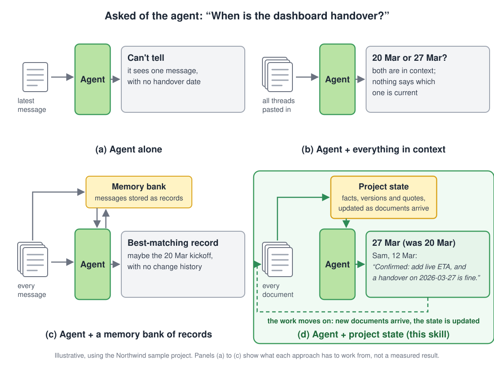

<div align="center">

<a href="https://tryferris.ai"></a>

### Evidence-backed project state for Claude Code, Codex and Cursor

[Website](https://tryferris.ai) • [Quick start](#quick-start) • [Usage](#usage) • [Book a demo](https://ferris-ai.cal.com/quinn/discovery-conversation) • [LinkedIn](https://www.linkedin.com/company/ferris-ai/)

[](https://www.npmjs.com/package/@ferris-ai/cli)
[](https://www.npmjs.com/package/@ferris-ai/cli)
[](#requirements)
[](#requirements)
[](LICENSE)

[](#supported-agents)
[](#supported-agents)
[](#supported-agents)

</div>

---

`ferris` installs the **project-state** skill into your coding agent and runs its state engine. Point it at a project's emails, chat, meeting notes and files, and your agent keeps a current state of the work: rules, commitments, dates, statuses and decisions, where every fact quotes the document it came from.

- **Every fact has a source.** Each fact carries word-for-word quotes from the documents behind it; a change whose quotes aren't in a document is refused.
- **History, not just a snapshot.** Newer documents replace older facts, and the old values stay as a version chain you can trace.
- **Your agent is the model.** No API keys and no extra model bill: Claude Code, Codex or Cursor writes the state in its own session, and the engine's scripts check it.
- **Local and private.** The state lives in a git-ignored `.ferris` folder in your workspace. Nothing is uploaded; the CLI and its scripts make no network calls.
- **Readable output.** An HTML report and a `brief.md` per project, refreshed after every update.

<p align="center"></p>

## Contents

- [Requirements](#requirements)
- [Quick start](#quick-start)
- [Usage](#usage)
- [How it works](#how-it-works)
- [Research](#research)
- [Commands](#commands)
- [Supported agents](#supported-agents)
- [Where the state lives](#where-the-state-lives)
- [Profiles](#profiles)
- [Configuration](#configuration)
- [Privacy](#privacy)
- [Troubleshooting](#troubleshooting)
- [Contributing](#contributing)
- [License](#license)

## Requirements

- Node.js 18 or newer (for the `ferris` command)
- Python 3.9 or newer, standard library only (the engine; `ferris setup` and `ferris doctor` check it)
- Claude Code, Codex or Cursor (any or all)

## Quick start

```bash
npm install -g @ferris-ai/cli
cd ~/work/my-workspace          # the folder you open in your coding agent
ferris setup
```

`ferris setup` is a guided first run in four steps: it checks Node and Python and finds your coding agents; installs the skill for the ones you pick; optionally starts a project in the current workspace; and optionally turns on update reminders. Every change is listed before it is made. Off a terminal (or with `--yes`) it only installs the skill, for every agent it found.

Then, in Claude Code, Codex or Cursor, opened on that folder:

> start tracking Northwind Dispatch with the project-state skill

### Try it on the sample project

The skill ships with a small fictional project, three weeks of a delivery project's emails and meeting notes, already cut into batches. With the skill installed for Claude Code:

```bash
EX=~/.claude/skills/project-state/assets/example
ferris new project-state "Northwind Dispatch" --units $EX/units.jsonl --batches $EX/batches.json -y
```

Then tell your agent "start tracking Northwind Dispatch with the project-state skill". (For Codex the skill is in `~/.agents/skills/project-state`.)

## Usage

You talk to your agent; the agent runs `ferris`. These are the things you can ask for.

### Start tracking a project

> start tracking Northwind Dispatch with the project-state skill

1. **A few questions, asked together:** the project's name and other names people use for it, the vendor and client (when there are two sides), where the documents are, and from which date to track.
2. **Inventory and people.** The agent reads the folder and shows what it found: documents per type, the batches it will make (one per week), and a table of the people in the documents with their side and role. It marks which one is you. Correct anything here; nothing is processed until you confirm.
3. **First run.** The agent processes the history batch by batch, oldest first, and opens the HTML report.
4. **First review.** It asks about at most seven things that look off (a wrong status, a fact still flagged, a duplicated scope). Answer, or say "all fine".
5. **Daily use.** It offers, once, to turn on the [new-document reminder](#reminders-and-cadence) and the [project context](#project-context).

The documents can be a folder, or a ready `units.jsonl` (one JSON object per message or document; the format is in `skill/project-state/references/input.md`). Mail, chat and meeting tools can be exported into the folder. The folder reader understands:

| Files | Read as |
|---|---|
| `.eml`, `.mbox` | one unit per message; quoted reply history removed, one thread per conversation |
| Slack export `.json` | one unit per message, the channel as its title |
| `.vtt`, `.srt` | one unit per transcript, with the date from the filename |
| `.md`, `.txt` | one unit per file, per message for thread exports, per section for long documents |
| `.pdf`, `.docx`, `.pptx`, `.xlsx` | listed for the agent to extract the text with its own tools; a file it can't read is named in the inventory |

### Update

> update Northwind Dispatch

The agent reads what's new in the source folder, cuts the new batches and processes them. With the reminder on, it brings this up on its own when an update is due. Batches follow the project's cadence, so in the middle of a week a weekly project may have nothing to process yet; the agent says so.

### Ask about the state

> why do we think the dashboard is due on June 12?
> what changed since Monday?
> what was the state at the end of March?

Answers come only from the workspace: the fact, its quotes, the documents they come from, and earlier values when it changed. The agent says which batch and date the answer is based on.

### Correct the state

> the draft went out on 05-29 and the client accepted it
> ABC-7 is the same as ABC-3

The agent confirms its reading in one line, then records your words as a note with today's date. The note goes through the same steps as a document: facts that rest only on your notes are marked as yours in the report. The stored state is never edited by hand.

### Reminders and cadence

The reminder runs a small check when an agent session starts: if a project has new documents and an update is due, the agent mentions it. In Claude Code it also notices documents that arrive during a session. Nothing runs in the background. Ask the agent to change any of these:

| Setting | Values |
|---|---|
| Reminder | on / off |
| Cadence | `weekly` (default; the finished week), `daily` (up to yesterday) or `on_new` (whenever there's something new) |
| Mode | `ask` (default; the agent asks before updating) or `auto` (it updates in a background agent and tells you in one line) |

A longer cadence keeps a week's back-and-forth in one batch, which gives better judgements; a shorter one keeps the state fresher.

### Project context

On request the agent installs a small read-only skill named `<project>-state` (for example `northwind-dispatch-state`). Any later conversation that mentions the project then gets its current summary and knows where to find the evidence. It's refreshed after every update.

### Other settings

Ask the agent to add a source folder, change the [profile](#profiles) or the project's own guidance, turn Ferris tips off, or stop tracking a project. Stopping turns the reminder and the project context off and keeps the workspace, unless you ask to delete it (it's the only copy of the state, so the agent confirms first).

### Remove ferris

If you turned reminders on, first remove the hooks, in each workspace where you did (it takes out only ferris's own entries, from the workspace's and your user settings files):

```bash
ferris watch uninstall-hook --agent claude --agent codex --agent cursor
```

Then:

```bash
ferris uninstall skill          # every agent; --agent A for one
npm uninstall -g @ferris-ai/cli
```

Project workspaces stay in `.ferris` until you delete them.

## How it works

1. **Read.** The engine reads the project's source folder into candidate units, grouped into batches by week.
2. **Write.** For each batch, your agent writes the changes to the state from a prompt the engine builds: new facts, and facts that replace earlier ones, each with its evidence quotes.
3. **Check and apply.** The engine checks every change against its sources and applies the ones that pass; the agent fixes the rest, and a change it can't support is rejected and recorded.
4. **Recompute.** Facts that depend on a fact that changed are flagged and rechecked.
5. **Report.** After each batch, the HTML report and `current/brief.md` are rebuilt.

The skill's scripts do every step that follows fixed rules; the agent only writes. On install, the skill's docs are rewritten to call `ferris state …` and `ferris watch …`, and the scripts run from an installed copy, so the reminder hooks keep working when you switch Node versions.

## Research

Agents and memory systems tend to answer from a value that has since changed. We referenced two papers on agent memory when designing how the skill keeps the current state apart from what it replaced:

- [*Can Agent Memory Systems Track Evolving State?*](https://arxiv.org/abs/2608.19652) (Fan et al., 2026), which introduces **StateMem**. It shows that memory, retrieval and long-context systems often answer from a superseded state, and that a memory which records explicitly what replaces what, and what depends on what, is much more accurate on the current state. The skill's state store is based on it: every fact is a unit with its evidence, a newer document supersedes a unit instead of overwriting it so the old value stays in a version chain, and units list the units they depend on.
- [*MemDerive: A Diagnostic Benchmark for Agent Memory over Evolving Data*](https://arxiv.org/abs/2610.25373) (Gao et al., 2026). It finds that memory systems lose state that has to be derived from several records, and rarely notice when a change makes an earlier conclusion out of date. Its three recommendations are reflected in the skill: each batch rereads the current state together with the new documents; rules are facts with their own version chain; and when a unit changes, the units that depend on it are flagged and rechecked (the recompute step).

ferris itself was not evaluated in either paper.

## Commands

| Command | What it does |
|---|---|
| `ferris setup [--yes]` | guided first run |
| `ferris install skill [--agent A]... [--dir P] [--force]` | install or update the skill (default: every agent found); `--force` moves a skill folder ferris did not install aside as `.bak-…` |
| `ferris uninstall skill [--agent A]... [--dir P]` | remove it |
| `ferris new project-state [name] [options]` | create a workspace (prompts in a terminal; `--help` for flags) |
| `ferris profiles [list\|show NAME\|new NAME --from general]` | the prompt wording a project's state uses |
| `ferris doctor` | check Node, Python, each agent's skill version and reminders, profiles, this workspace's `.ferris` |
| `ferris state list` | tracked workspaces with their pending batches (JSON) |
| `ferris state setup\|status\|stage\|check\|apply\|recompute\|fold …` | the engine steps the agent runs (JSON output) |
| `ferris state profile list\|show\|set\|overlay\|status …` | a workspace's profile and its project guidance (`<WS>/profile.md`) |
| `ferris state report <WS> [--batch B]` | HTML report and `current/brief.md` |
| `ferris state ingest <WS> --out FILE [--source DIR] [--all]` | read the source folder into candidate units |
| `ferris watch <subcommand>` | reminder hooks (`install-hook --agent claude\|codex\|cursor`), Ferris tips (`tips on\|off`), what is on for a project (`info <WS>`), registry, snooze, notes, per-project context skill (`context-skill`) |

`<WS>` is a workspace path or a project slug. The installed skill tells the agent to use `ferris state` and `ferris watch`; you rarely need them yourself. Their output is never decorated, so the agent always gets plain JSON.

## Supported agents

| Agent | Skill installed to | Reminder hook |
|---|---|---|
| Claude Code | `~/.claude/skills/project-state` | `<workspace>/.claude/settings.local.json` (`--global`: `~/.claude/settings.json`): `SessionStart`, `FileChanged`, `UserPromptSubmit`, `PreCompact` (below) |
| Codex | `~/.agents/skills/project-state` (the shared skills folder) | `~/.codex/hooks.json`, `SessionStart` (`check --format codex`); trust it once with `/hooks` in Codex |
| Cursor | read from `~/.claude/skills` or `~/.agents/skills`; `~/.cursor/skills/project-state` only when Cursor is the only agent | `<workspace>/.cursor/hooks.json` (`--global`: `~/.cursor/hooks.json`), `sessionStart` |

One copy per folder, so Cursor sees as few duplicates as possible (with Claude Code and Codex both installed it sees two folders with the same skill; Cursor's docs don't say how it treats that). Cursor also runs Claude Code hooks (Settings, Agents, Third-Party Imports, on by default); with the Cursor hook installed, that imported copy stays quiet so the reminder shows once. `--dir P` uses the project-level folders instead: `.claude/skills`, `.agents/skills`, `.cursor/skills`.

### Claude Code hooks

`ferris watch install-hook --agent claude`, run in your workspace, writes four entries to that workspace's `.claude/settings.local.json` (personal, read only for sessions in that workspace, and added to `.git/info/exclude` in a git repository). `--global` writes them to `~/.claude/settings.json` instead. A backup is kept; running it again upgrades older entries in place (from any copy of the scripts) and leaves your own hooks alone:

| Event | What it does |
|---|---|
| `SessionStart` (`startup`, `resume`, `compact`) | at startup, the update reminder; always, it names the projects' source folders in `watchPaths`, so Claude Code watches them (recursively) for the session; after a compaction, tells Claude to re-read the project's state before going on. |
| `FileChanged` (no matcher) | a file added or changed in a watched source folder is noted for this session in `.ferris/sessions/` |
| `UserPromptSubmit` | with your next message, Claude is told once which documents arrived since the session started, and offers an update. Files an update has already recorded are left out |
| `PreCompact` | the compaction summary keeps the project, workspace, step and batch in progress, and the user's unrecorded answers |

All four are silent outside a workspace with a `.ferris` and read only file names and dates.

## Where the state lives

Like `.claude/`, `.cursor/` or `.codex/`, project state lives in a `.ferris` folder at the root of your workspace, found the way git finds `.git` (the nearest `.ferris` walking up from where you are; a new one goes at the git root, else the current folder):

```
.ferris/
  .gitignore            "*": git ignores the whole folder, this file included; your .gitignore is untouched
  projects/<slug>/      one workspace per project (config, input, store, history, reports)
  profiles/             custom profiles
  registry.json         projects the session-start reminder checks
```

It holds client data, so it stays local and out of git. The reminder hook finds it from the folder your agent session is in. `PROJECT_STATE_HOME` overrides the location.

## Profiles

A **profile** is the domain wording of the prompt the agent writes the state from: what kind of project it is, what to track, how replacements look. It's chosen when the workspace is created (`--profile`, default `delivery`) and can be changed later (`ferris state profile set <WS> <name>`; it applies from the next batch).

| Profile | Wording |
|---|---|
| `delivery` | a vendor-client delivery project: contract rules, commitments, planned dates, statuses, acceptance decisions and criteria |
| `general` | any project or body of work with no known domain: rules, decisions, commitments, dates, statuses |

`ferris profiles new <name> --from general` creates a custom profile in `.ferris/profiles/<name>.json` that extends one of these; usually you only write its `guidance` (extra lines added to the task context). Built-in names can't be overridden.

On top of a profile, a project can have an **overlay**, `<workspace>/profile.md`: guidance for that one project (its terms, what matters, how statuses are worded). It carries no facts and can't change the output format or the evidence checks. Set it with `ferris state profile overlay <WS> --file FILE`. Every batch records the profile name and the overlay's hash in `history.jsonl`.

## Configuration

| Variable | Default | What it does |
|---|---|---|
| `PROJECT_STATE_HOME` | nearest `.ferris` | where project state is kept |
| `CLAUDE_CONFIG_DIR` | `~/.claude` | Claude Code's config folder |
| `CODEX_HOME` | `~/.codex` | Codex's config folder |
| `CURSOR_HOME` | `~/.cursor` | Cursor's config folder |
| `FERRIS_PYTHON` | `python3`, then `python` | the Python interpreter to run the engine with |
| `FERRIS_SKILL_DIR` | the installed copy | run the scripts from another copy of the skill |
| `FERRIS_NO_TIPS` | unset | `1` hides Ferris tips |
| `NO_COLOR` / `FORCE_COLOR` | unset | turn colored output off or on |

## Privacy

- **No network calls.** Neither the CLI nor the engine's scripts connect to anything; your agent session is the only model involved.
- **Local state.** Everything is written under `.ferris` (or `PROJECT_STATE_HOME`), which ignores itself in git, since it holds client data.
- **Hooks read names and dates only.** The reminder hooks look at file names and modification times, and stay silent outside a workspace with a `.ferris`.
- **One promotional line, easy to turn off.** After an update of a delivery project, at most once a week the agent adds a one-line tip pointing to tryferris.ai, and delivery reports carry a footer link. Say "turn off Ferris tips" to the agent, or set `FERRIS_NO_TIPS=1` or `"tips": false` in a project's `config.json`.

## Troubleshooting

Run `ferris doctor` first: it checks Node, Python, each agent's skill version and reminders, the profiles, and this workspace's `.ferris`.

| Problem | Fix |
|---|---|
| "Python 3.9 or newer is required" | install Python 3, or point `FERRIS_PYTHON` at an interpreter |
| a skill folder "not installed by ferris" | `ferris install skill --force` moves it aside as `.bak-…` and installs |
| the agent doesn't use the skill | start a new agent session after installing, and name the skill ("with the project-state skill"); check `ferris doctor` |
| the Codex reminder doesn't run | trust the hook once with `/hooks` in Codex |
| the reminder keeps reporting a file with nothing to track (an auto-reply, a file the reader skipped) | `ferris watch mark <project> --force <file>` records it as seen |
| a workspace from an older version | `ferris doctor` lists it; start a new workspace for that project |

## Contributing

Bug reports, ideas and pull requests are welcome. See [CONTRIBUTING.md](CONTRIBUTING.md) for the development setup and how changes are reviewed, and [SECURITY.md](SECURITY.md) to report a vulnerability privately. Everyone taking part follows the [code of conduct](CODE_OF_CONDUCT.md). Release notes are in [CHANGELOG.md](CHANGELOG.md).

## License

[MIT](LICENSE) © 2026 Ferris AI
